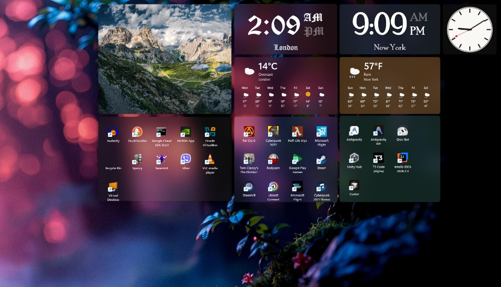

# Desktop Panels

Desktop Panels is a Windows app that replaces the usual desktop icon grid with movable, translucent panels. While it is running, Explorer’s desktop icons are hidden and those shortcuts appear inside panels that sit on the wallpaper, behind other windows.

The layout is saved automatically and restored the next time the app starts. Quitting, or an unexpected exit, puts the original desktop icons back.

One layout, sitting on the wallpaper: a slideshow, clocks for two cities plus an analog face, weather with a weekly forecast, and shortcut panels grouped by use.



## Panels

Create panels from the system tray, or from the add button that appears when you hover a panel.

### Shortcut panels

The default panel collects the shortcuts that were on the desktop, including special items such as the Recycle Bin.

- Double-click an icon to open it.
- Right-click for the Windows shell menu, including Open, Rename, Delete, and Properties.
- Drag icons between shortcut panels. Icons from a panel you remove return to the default panel.
- The desktop is scanned every few seconds, so new, renamed, and removed shortcuts show up without a restart.
- The default shortcut panel stays in place and cannot be removed.

### Folder panels

Point a panel at any folder and it shows that folder’s contents as icons. Open, rename, and delete items from the shell menu. The view refreshes as the folder changes.

### Slideshow panels

Play images from a folder.

- Supported files: JPEG, PNG, GIF, WebP, and BMP.
- Choose how long each image stays on screen (2 seconds to 1 hour).
- Fit images with Cover or Contain.
- Transitions fade from one image to the next, and the folder is re-read as the show advances.

### Clock panels

Show the time for the local zone or any time zone installed on the PC.

- Digital face, which scales to fit the panel, or a Swiss analog face with a second hand.
- 12-hour or 24-hour time, with seconds optional.
- A city label you can show or hide.
- Any font installed on the computer.

### Weather panels

Show the current conditions and an illustrated forecast for a city. Weather comes from [Open-Meteo](https://open-meteo.com/) and does not need an API key.

- Search for a city, then pick a result.
- Fahrenheit or Celsius.
- Optional seven-day high and low.
- Conditions are drawn as clear, partly cloudy, cloudy, drizzle, rain, snow, thunder, or fog.
- The last reading is kept on disk and shown if the network is unavailable. A successful panel refreshes about every 20 minutes.

## Layout and appearance

- Drag a panel by its empty area to move it. Drag an edge or corner to resize it. The smallest size is 180 by 120.
- Panels snap to each other’s edges and sizes, with a small gap between them. A cue marks the edges that locked.
- Each panel can show or hide a title.
- Tint a panel Slate, Blue, Teal, Amber, Rose, or Graphite, and set how strong that tint is.
- On systems that support it, panels use a desktop acrylic backdrop. Otherwise they use a tinted translucent fill.
- Settings preview live. Save keeps them; Cancel restores the panel and the startup setting to what they were when you opened settings.
- Hover a panel for Add, Settings, and Remove. The first panel cannot be removed.
- Windows are frameless, rounded, and kept out of Alt+Tab. They stay at the bottom of the window order so normal apps cover them.

## Desktop integration

- A tray icon opens the menu: new shortcut, folder, slideshow, clock, or weather panel, show or hide desktop icons, and quit.
- Showing desktop icons brings Explorer’s icon list back without quitting. Hiding them returns you to the panels.
- One instance runs at a time. Starting the app again does nothing if it is already open.
- Optional **Start with Windows**, from any panel’s settings. The app uses a Startup-folder shortcut.
- The layout is stored at `%AppData%\DesktopPanels\layout.json`.
- If the process ends unexpectedly, a small watcher restores the desktop icons.
- DPI is per-monitor, so panels stay sharp when you move them between displays.

## Requirements

- Windows 10 version 1809 or later
- [.NET 10 SDK](https://dotnet.microsoft.com/download)
- Windows App SDK 2.5 (restored with the project)

## Build and run

```powershell
dotnet build
dotnet run
```

The project builds for x86, x64, and ARM64. With no runtime identifier set, it targets the architecture of the machine you build on.
